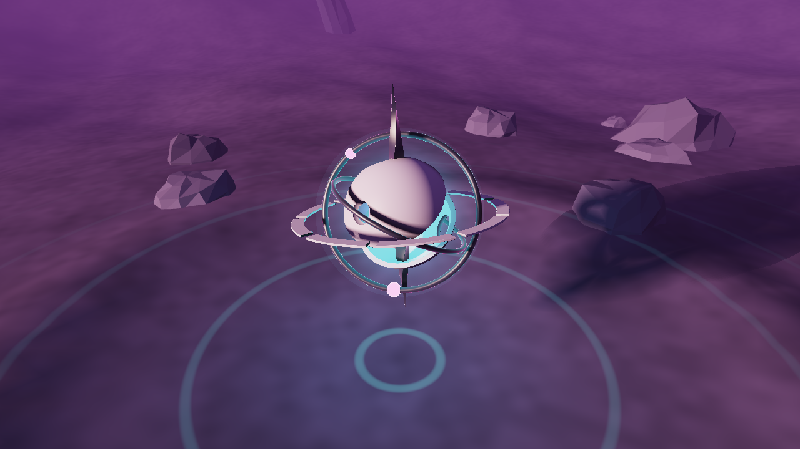

# The Anomaly — um artefato alienígena procedural

Projeto da disciplina de Fundamentos de Processamento Gráfico (Sistemas de Informação).

Uma cena 3D de ficção científica: um planeta alienígena escuro, com um gigante gasoso no céu, e no centro uma escultura geométrica que flutua sobre uma pequena cratera. A escultura combina formas matemáticas (anéis, esferas, cascas) com deformações orgânicas e movimentos lentos, como se fosse uma anomalia que não pertence àquele mundo.


| Contra a estrela principal | Vista de cima (sombra da escultura no chão) |
|---|---|
|  |  |

## Tecnologias

- **C++17** para a aplicação
- **OpenGL 3.3 Core** para a renderização
- **GLSL** para os shaders (ray marching, céu e iluminação)
- **GLFW** para janela e entrada (baixado automaticamente pelo CMake)
- **GLM** para vetores e matrizes (baixado automaticamente pelo CMake)
- **GLAD** para carregar as funções do OpenGL (já incluído em `external/glad`)
- **CMake** para a compilação

## Como compilar e executar

É preciso ter um compilador C++17, CMake 3.14+ e acesso à internet na primeira configuração (para baixar GLFW e GLM).

### Linux

Dependências do sistema (Ubuntu/Debian):

```bash
sudo apt install build-essential cmake libgl1-mesa-dev libx11-dev libxrandr-dev libxinerama-dev libxcursor-dev libxi-dev
```

Compilação e execução:

```bash
cmake -S . -B build
cmake --build build -j
./build/anomaly
```

### Windows (Visual Studio)

```bash
cmake -S . -B build
cmake --build build --config Release
build\Release\anomaly.exe
```

Também é possível abrir a pasta diretamente no Visual Studio ou no CLion, que reconhecem o `CMakeLists.txt`.

### macOS

Os mesmos comandos do Linux funcionam com as Xcode Command Line Tools e o CMake instalados.

> Os shaders são lidos da pasta `shaders/` do projeto (o caminho é definido pelo CMake), então podem ser editados sem recompilar: basta pressionar **F5** com o programa aberto.

## Controles

| Entrada | Ação |
|---|---|
| Arrastar com o botão esquerdo | Girar a câmera ao redor da escultura |
| Roda do mouse | Aproximar / afastar |
| `A` | Liga/desliga a órbita automática da câmera |
| `Espaço` | Pausa/retoma a animação |
| `R` | Volta para o enquadramento inicial |
| `F5` | Recarrega os shaders |
| `Esc` | Fecha o programa |

## Estrutura do projeto

```
src/
  main.cpp          janela, câmera, laço principal e ordem dos passes de renderização
  shader.cpp/.h     carregamento e compilação dos shaders (com suporte a #include)
  geometry.cpp/.h   malhas do terreno e das rochas
shaders/
  common.glsl         uniforms, paleta, céu, neblina e tone mapping compartilhados
  sculpture_sdf.glsl  SDFs da escultura e sombra suave
  sculpture.frag      ray marching e materiais da escultura
  sky.frag            céu, estrelas, estrela principal e planeta com anéis
  scene.vert/.frag    terreno e rochas (geometria convencional)
  fullscreen.vert     triângulo de tela cheia usado pelo céu e pela escultura
external/glad/        loader do OpenGL gerado pelo GLAD
docs/screenshots/     capturas da aplicação
```

## Como a cena é renderizada

A cena usa uma abordagem **híbrida**, desenhada em três passes por quadro:

1. **Céu** — um triângulo que cobre a tela. Para cada pixel, o shader reconstrói a direção do raio da câmera (com a inversa da matriz view-projection) e calcula o gradiente do céu, as estrelas, o disco da estrela principal e o planeta com anéis (interseção raio-esfera e raio-plano).
2. **Terreno e rochas** — geometria convencional com VBO/VAO. O terreno é uma grade cuja altura vem de *value noise* (fBm) com uma cratera no centro e montanhas ao longe. As rochas são esferas low-poly deformadas por ruído e com normais por face; as estruturas altas ao fundo são as mesmas rochas esticadas.
3. **Escultura** — outro triângulo de tela cheia, agora com **ray marching**. O shader escreve `gl_FragDepth` com a profundidade do ponto encontrado, então a escultura é corretamente ocultada pelas rochas e se mistura com o resto da cena pelo depth buffer.

Os três shaders compartilham `common.glsl` (paleta, direção da luz, neblina, tone mapping), o que mantém as cores e a iluminação coerentes. O terreno e as rochas também incluem `sculpture_sdf.glsl` para receber a **sombra da escultura**.

### SDFs e construção da escultura

Uma função de distância assinada (SDF) retorna, para um ponto `p`, a distância até a superfície mais próxima (negativa dentro do objeto). A escultura inteira é a função `sculptureMap(p)` em `shaders/sculpture_sdf.glsl`, que devolve a distância e um id de material. Ela é composta por:

- **Núcleo** — esfera com deslocamento senoidal animado (`sin(x)·sin(y)·sin(z)`), que faz a superfície "respirar". É emissivo e pulsa entre ciano e magenta.
- **Espinho cristalino** — caixa estreita que afina nas pontas, torcida ao longo do eixo Y e levemente inclinada, unida ao núcleo por **união suave** (`opSmoothUnion`), o que cria a transição orgânica entre os dois.
- **Casca** — uma casca esférica (`abs(sdSphere) - espessura`) da qual são **subtraídas** uma faixa central e quatro esferas, sobrando duas calotas assimétricas com furos.
- **Dois anéis (toros)** que se cruzam e oscilam em eixos diferentes, com duas esferas brilhantes parcialmente incrustadas.
- **Anel externo achatado** com nove cortes feitos por **repetição polar** (um único corte replicado ao redor do anel).

As operações usadas são união (`min`/`closest`), subtração (`max(a, -b)`) e união suave. Rotações dependentes do tempo em cada parte produzem as animações.

### Ray marching

Em `shaders/sculpture.frag`, para cada pixel:

1. O raio é testado contra uma **esfera envolvente**; se não a atingir, o pixel é descartado (isso evita gastar processamento no resto da tela).
2. O raio avança pela distância retornada pela SDF (*sphere tracing*), com um fator de 0,7 porque as deformações tornam a SDF apenas aproximada. Para quando a distância fica muito pequena (acerto) ou quando sai da esfera envolvente.
3. A **normal** é estimada pelo gradiente da SDF (diferenças centrais).
4. O ponto é iluminado com:
   - luz difusa e especular (Blinn-Phong) da estrela principal;
   - **sombra suave** obtida marchando um raio até a luz;
   - **oclusão ambiente** amostrando a SDF ao longo da normal;
   - luz pontual ciano emitida pelo núcleo;
   - reflexo do céu e borda iridescente (efeito Fresnel) no material metálico.
5. Um **halo** em volta do núcleo é calculado pela menor distância entre o raio e o centro do artefato.

### Animação

Todas as animações usam o tempo acumulado (`deltaTime` somado a cada quadro), então a velocidade não depende da taxa de quadros: flutuação vertical do artefato, rotação lenta do conjunto, anéis girando em eixos diferentes, núcleo pulsando e se deformando, e ondas de energia saindo do artefato pelo chão.

## Funcionalidades prontas

- [x] Projeto C++/OpenGL com CMake, compilando em Linux (testado) e preparado para Windows/macOS
- [x] Escultura central feita com SDFs e ray marching
- [x] União, subtração, união suave e repetição polar de SDFs
- [x] Iluminação com luz direcional, especular, sombra suave, oclusão ambiente e luz emissiva do núcleo
- [x] Terreno procedural simples com cratera e montanhas ao longe
- [x] Rochas low-poly e estruturas distantes
- [x] Céu com estrelas, estrela principal e planeta com anéis
- [x] Neblina e tone mapping consistentes entre todos os passes
- [x] Integração por profundidade entre ray marching e geometria rasterizada
- [x] Animações independentes das partes do artefato
- [x] Câmera orbital com mouse e órbita automática
- [x] Recarregamento de shaders em tempo de execução (F5)

## Melhorias planejadas

- Sombras das rochas e do terreno (shadow mapping)
- Partículas orbitando a escultura
- Mais componentes e deformações na escultura
- Terreno mais detalhado e novas formações alienígenas
- Bloom para as partes emissivas
- Controles de câmera mais completos e interação com elementos da cena

## Desempenho

O ray marching é executado apenas dentro da esfera envolvente da escultura. Em uma GPU dedicada ou integrada recente a cena roda em tempo real; no ambiente de desenvolvimento, sem GPU (renderização por software com Mesa llvmpipe), roda a cerca de 4 FPS em 1280×720. A taxa de quadros aparece no título da janela.
