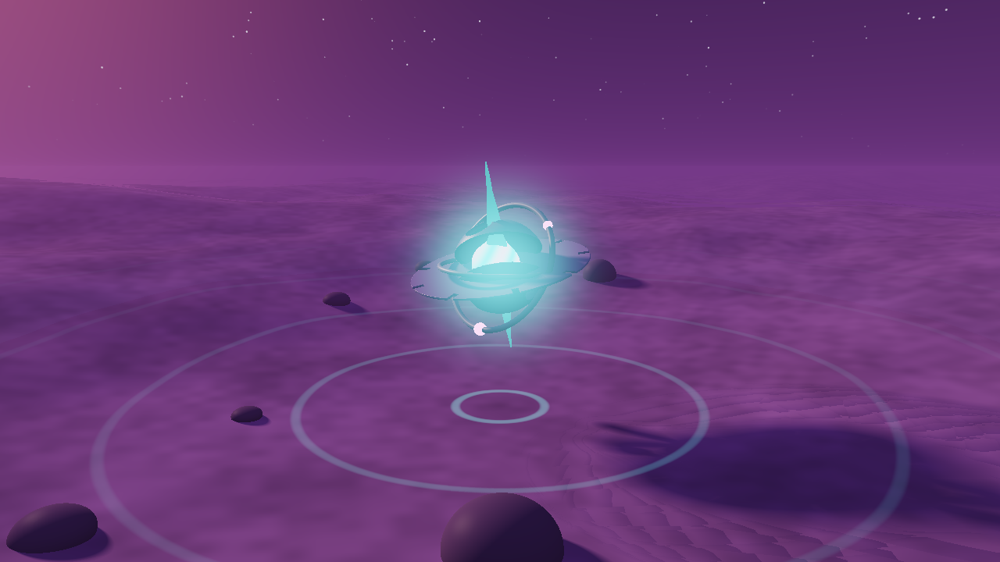
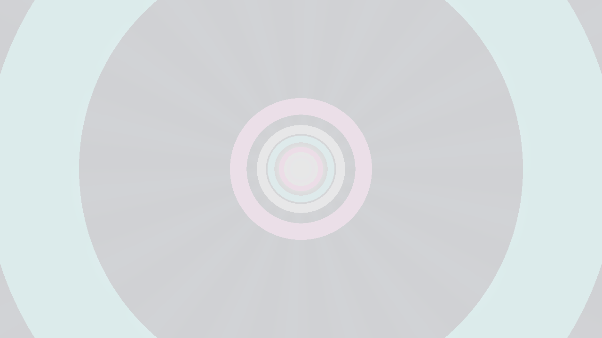
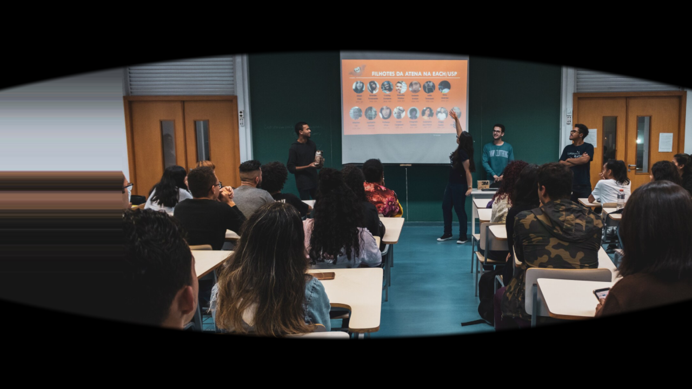

# The Anomaly — um artefato alienígena procedural

Projeto da disciplina de Fundamentos de Processamento Gráfico (Sistemas de Informação).

Uma cena 3D de ficção científica: um planeta alienígena escuro e no centro uma escultura geométrica que flutua sobre uma pequena cratera, construída com CSG sobre funções de distância (SDF). Ao abrir, o programa reproduz uma narrativa de cerca de 30 segundos: a câmera se aproxima, o artefato desperta, a realidade se fratura num túnel de luz e a cena termina numa sala de aula da EACH-USP.



**Toda a imagem é calculada por ray marching.** Seguindo o modelo da engine `RayMarching_Luz` vista em aula, um único quad em tela cheia dispara um fragment shader (`shaders/Image.frag`) que resolve geometria, iluminação, sombras, partículas, a transição e a foto final — nenhuma geometria é rasterizada.

## Tecnologias

- **C++17** para a aplicação
- **OpenGL 3.3 Core** para a renderização (só o quad em tela cheia)
- **GLSL** para os shaders (ray marching, céu, iluminação, transição)
- **GLFW** para janela e entrada (baixado automaticamente pelo CMake)
- **GLM** para vetores e matrizes (baixado automaticamente pelo CMake)
- **GLAD** para carregar as funções do OpenGL (já incluído em `external/glad`)
- **CMake** para a compilação

## Como compilar e executar

É preciso ter um compilador C++17, CMake 3.14+ e acesso à internet na primeira configuração (para baixar GLFW e GLM).

### Linux

Dependências do sistema (Ubuntu/Debian):

```bash
sudo apt install build-essential cmake libgl1-mesa-dev libx11-dev libxrandr-dev libxinerama-dev libxcursor-dev libxi-dev
```

Compilação e execução:

```bash
cmake -S . -B build
cmake --build build -j
./build/anomaly
```

### Windows (Visual Studio)

É preciso ter o Visual Studio com a carga de trabalho "Desenvolvimento para desktop com C++" e o CMake. No PowerShell, rode um comando por vez (o Windows PowerShell não aceita `&&`):

```powershell
cmake -S . -B build
cmake --build build --config Release
.\build\Release\anomaly.exe
```

Com MinGW ou Ninja, o executável fica em `.\build\anomaly.exe`.

Também é possível abrir a pasta diretamente no Visual Studio ou no CLion, que reconhecem o `CMakeLists.txt`.

### macOS

Os mesmos comandos do Linux funcionam com as Xcode Command Line Tools e o CMake instalados.

> Os shaders são lidos da pasta `shaders/` do projeto (o caminho é definido pelo CMake), então podem ser editados sem recompilar: basta pressionar **F5** com o programa aberto.

## Controles

| Entrada | Ação |
|---|---|
| Arrastar com o botão esquerdo | Girar a câmera ao redor da escultura |
| Roda do mouse | Aproximar / afastar |
| `A` | Liga/desliga a órbita automática da câmera |
| `Espaço` | Pausa/retoma a animação |
| `R` | Volta para o enquadramento inicial |
| `F5` | Recarrega os shaders |
| `P` | Liga/desliga as partículas |
| `N` | Reinicia a narrativa |
| `M` | Sai da narrativa e vai para o modo livre |
| `Esc` | Fecha o programa |

Durante a narrativa a câmera é controlada pela linha do tempo, então o mouse, a roda e as teclas `A`, `R` e `P` só funcionam no modo livre (`M`). As outras teclas continuam funcionando, e `Espaço` também pausa a narrativa.

## Estrutura do projeto

```
src/
  main.cpp          janela, câmera, laço principal e uniforms do shader (estilo da engine)
  shader.cpp/.h     carregamento e compilação dos shaders (com #include e proteção contra ciclos)
  story.cpp/.h      linha do tempo da narrativa (câmera, velocidade e efeitos de cada etapa)
  texture.cpp/.h    carregamento da foto da sala de aula como textura (iChannel0)
shaders/
  fullscreen.vert   quad em tela cheia que dispara o fragment shader
  Image.frag        a cena inteira: getDist, ray marching, luz, partículas, transição e a foto
  sculpture.glsl    a escultura como uma única Surface CSG
  common.glsl       Surface, SDFs, operações CSG, ruído, paleta, céu, neblina e tone mapping
external/glad/      loader do OpenGL gerado pelo GLAD
external/stb/       stb_image.h, para ler a foto (JPG/PNG)
assets/             foto da sala de aula (sala-each.jpg)
docs/screenshots/   capturas da aplicação
```

## Como a cena é renderizada

Tudo acontece em `Image.frag`, no estilo da engine do professor:

1. O vertex shader desenha um quad que cobre a tela.
2. Para cada pixel, o fragment shader monta um raio a partir da câmera (`SetCamera`, look-at) e faz **sphere tracing** sobre a função `mapDist(p)`.
3. `mapDist` devolve uma `Surface` — distância + cor + coeficientes de material (`Ka`, `Kd`, `Ks`) + emissivo — que une por CSG o terreno, as rochas e a escultura.
4. O ponto atingido é iluminado em `getLight`: ambiente hemisférico, Blinn-Phong da estrela, sombra suave por um segundo ray marching, luz do núcleo e emissivo do material.
5. Se o raio não atinge nada, `renderSky` calcula o céu: gradiente, estrelas por hash, a estrela principal e o planeta com anéis (interseção raio-esfera e raio-plano).
6. Brilhos acumulados ao longo do raio (partículas e halo do núcleo), neblina e tone mapping ACES fecham a imagem.

### Superfícies e CSG

A cena é montada combinando `Surface`s com `unionS` (o material do mais perto vence), união suave (`opSmoothUnion`) e subtração (`opSub`, que é `max(a, -b)`):

- **Terreno** — um campo de altura por *value noise* (duas oitavas), com a distância amortecida para a marcha não furar o relevo; a cratera achata ao redor do artefato e sobe ao longe.
- **Rochas** — sete elipsoides espalhados por `hash` (posição, escala e rotação determinísticas).
- **Escultura** (`sculpture.glsl`) — núcleo orgânico (esfera deformada por senos) unido suavemente a um espinho torcido; casca esférica cortada por uma faixa e quatro furos (subtração); dois toros cruzados com gemas emissivas; e um anel externo achatado com nove cortes feitos por **repetição polar** (`mod` no ângulo).

### Sombras por ray marching

Sem shadow map: a sombra é um segundo `rayMarching` lançado do ponto iluminado em direção à estrela. O march guarda quão perto o raio passou de geometria (`min(10·h/t)`), o que produz penumbra suave de graça — a escultura, animada, também entra na mesma SDF e projeta sombra no chão.

### Luz do núcleo

O núcleo emite uma luz pontual que alterna entre ciano e magenta. Para saber se ela chega a um ponto, o shader marcha do ponto até o núcleo (`coreVisibility`): a casca, os anéis e o espinho bloqueiam a luz, que só escapa pelos furos — criando manchas no chão. Ondas de energia (`sin` radial com decaimento exponencial) saem do artefato pelo terreno, pulsando junto com o núcleo.

### Partículas sem instancing

Sem geometria instanciada, as partículas são calculadas no próprio fragment: cada uma é um ponto em órbita (raio e velocidade por `hash`, inclinação por anel) e contribui um brilho gaussiano quando o raio da câmera passa perto dela antes de atingir a superfície. O efeito é o das partículas orbitando o artefato com um brilho acumulado ao longo do raio.

### Narrativa: The Fracture

A linha do tempo fica em `src/story.cpp`: `evaluateStory(t)` devolve um `StoryFrame` com câmera, velocidade das animações, brilho do núcleo e progresso da transição, que o `main.cpp` envia como uniforms.

| Tempo | Etapa | O que acontece |
|---|---|---|
| 0–12 s | A aproximação | Câmera distante e alta, que se aproxima devagar; artefato quase parado e com o núcleo fraco |
| 12–24 s | O encontro | A câmera chega mais perto, o artefato começa a girar e a luz do núcleo aumenta |
| 24–38 s | O despertar | Rotação acelera, as partículas saem do núcleo e a câmera contorna o artefato com um leve tremor |
| 38–54 s | The Fracture | A imagem se torce, a câmera mergulha no núcleo e a cena vira um túnel ray-marcado de anéis de luz até o clarão |
| 54–62 s | O despertar na EACH-USP | A foto emerge do branco, sai do desfoque, pisca uma vez e a "cabeça" olha para os lados |
| 62–64 s | Fim | Corte para preto; a narrativa fica parada aí até `N` ou `M` |

Os tempos ficam em constantes no começo de `src/story.h` (`STORY_APPROACH_END`, `STORY_FRACTURE_END`, ...) em "segundos de narrativa": com `STORY_SPEED = 2.15`, a história inteira leva ~30 s reais. Cada etapa usa um progresso suavizado com `smoothstep`.



O túnel é uma segunda SDF no `mapDist`: quando `uFracture` chega ao fim, a cena inteira passa a ser um cilindro claro com aros torus emissivos que nascem no ponto de fuga e engolem a câmera (a geometria se move, a câmera fica — como no shader original). A névoa converge tudo para o branco, que faz a ponte com a sala.



### A foto da sala de aula

A foto vai para a GPU como a textura `iChannel0` (mesmo nome usado pela engine). No shader ela é desenhada em modo "cover" (preenche a tela sem deformar), emerge do branco do clarão, sai do desfoque com 4 amostras vizinhas e tem uma piscada feita com uma borda curva. O "olhar para os lados" é um deslocamento da amostragem, possível por causa do zoom um pouco maior que 1.

A foto é lida de **`assets/sala-each.jpg`** (JPG ou PNG, de preferência paisagem). Para trocar, basta substituir o arquivo ou mudar `CLASSROOM_IMAGE` em `src/main.cpp`. É a única imagem importada do projeto — todo o resto é gerado por fórmulas.

## Funcionalidades prontas

- [x] Projeto C++/OpenGL com CMake, compilando em Linux (testado) e preparado para Windows/macOS
- [x] Cena 100% por ray marching, no modelo da engine de aula (quad + `Image.frag` + `Surface`)
- [x] Escultura CSG: união, subtração, união suave e repetição polar de SDFs
- [x] Terreno e rochas procedurais como SDFs (campo de altura + elipsoides por hash)
- [x] Blinn-Phong, ambiente hemisférico, emissivo, sombra suave e luz do núcleo bloqueada — tudo por ray marching secundário
- [x] Céu com estrelas, estrela principal e planeta com anéis
- [x] Partículas orbitais e halo do núcleo como brilho acumulado ao longo do raio
- [x] Narrativa de ~30 s com câmera cinematográfica, túnel de luz por ray marching e "acordar" na sala de aula (`iChannel0`)
- [x] Câmera orbital com mouse, órbita automática e recarregamento de shaders (F5)

## Melhorias planejadas

- Mais componentes e deformações na escultura
- Terreno mais detalhado e novas formações alienígenas
- Efeitos de brilho em espaço de tela (bloom/god rays) via múltiplos buffers (`iChannel0–3` da engine suportam)

## Desempenho

O ray marching é executado por pixel em toda a tela. Em uma GPU dedicada ou integrada recente a cena roda em tempo real; no ambiente de desenvolvimento, sem GPU (renderização por software com Mesa llvmpipe), roda a poucos FPS em 1280×720. A taxa de quadros aparece no título da janela.
