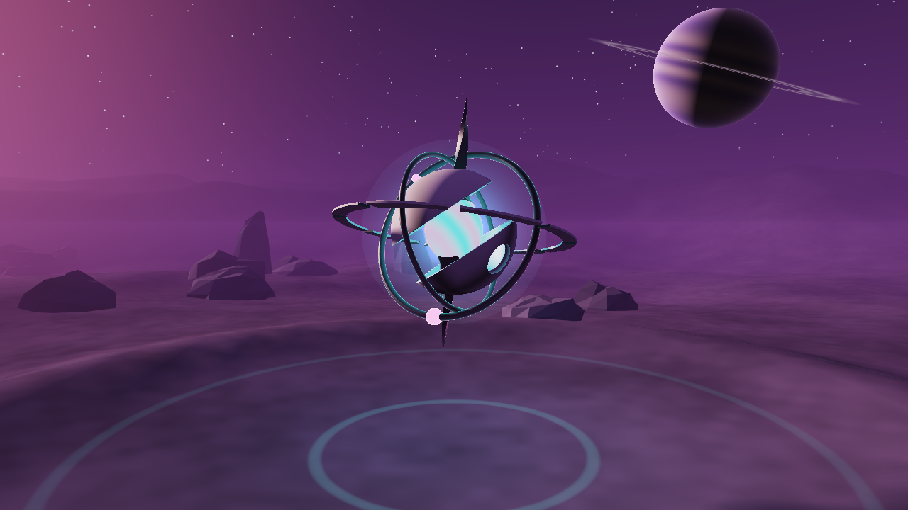
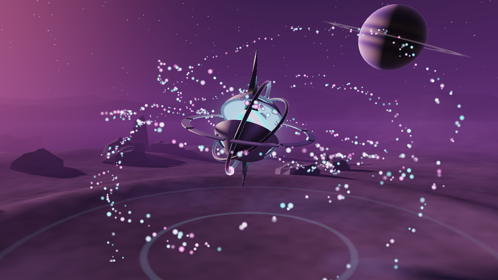
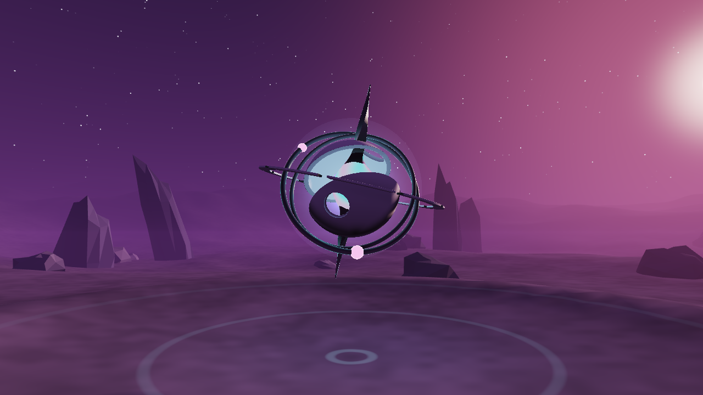

# The Anomaly — um artefato alienígena procedural

Projeto da disciplina de Fundamentos de Processamento Gráfico (Sistemas de Informação).

Uma cena 3D de ficção científica: um planeta alienígena escuro, com um gigante gasoso no céu, e no centro uma escultura geométrica que flutua sobre uma pequena cratera. A escultura combina formas matemáticas (anéis, esferas, cascas) com deformações orgânicas e movimentos lentos, como se fosse uma anomalia que não pertence àquele mundo.



| Sem bloom e god rays (teclas `B` e `G`) | Contra a estrela principal |
|---|---|
|  |  |

Ao abrir, o programa reproduz uma pequena narrativa de cerca de 60 segundos: a câmera se aproxima do artefato, ele desperta, a realidade se fratura e a cena termina numa sala de aula da EACH-USP (veja [Narrativa](#narrativa-the-fracture)).

## Tecnologias

- **C++17** para a aplicação
- **OpenGL 3.3 Core** para a renderização
- **GLSL** para os shaders (ray marching, céu e iluminação)
- **GLFW** para janela e entrada (baixado automaticamente pelo CMake)
- **GLM** para vetores e matrizes (baixado automaticamente pelo CMake)
- **GLAD** para carregar as funções do OpenGL (já incluído em `external/glad`)
- **CMake** para a compilação

## Como compilar e executar

É preciso ter um compilador C++17, CMake 3.14+ e acesso à internet na primeira configuração (para baixar GLFW e GLM).

### Linux

Dependências do sistema (Ubuntu/Debian):

```bash
sudo apt install build-essential cmake libgl1-mesa-dev libx11-dev libxrandr-dev libxinerama-dev libxcursor-dev libxi-dev
```

Compilação e execução:

```bash
cmake -S . -B build
cmake --build build -j
./build/anomaly
```

### Windows (Visual Studio)

É preciso ter o Visual Studio com a carga de trabalho "Desenvolvimento para desktop com C++" e o CMake. No PowerShell, rode um comando por vez (o Windows PowerShell não aceita `&&`):

```powershell
cmake -S . -B build
cmake --build build --config Release
.\build\Release\anomaly.exe
```

Com MinGW ou Ninja, o executável fica em `.\build\anomaly.exe`.

Também é possível abrir a pasta diretamente no Visual Studio ou no CLion, que reconhecem o `CMakeLists.txt`.

### macOS

Os mesmos comandos do Linux funcionam com as Xcode Command Line Tools e o CMake instalados.

> Os shaders são lidos da pasta `shaders/` do projeto (o caminho é definido pelo CMake), então podem ser editados sem recompilar: basta pressionar **F5** com o programa aberto.

## Controles

| Entrada | Ação |
|---|---|
| Arrastar com o botão esquerdo | Girar a câmera ao redor da escultura |
| Roda do mouse | Aproximar / afastar |
| `A` | Liga/desliga a órbita automática da câmera |
| `Espaço` | Pausa/retoma a animação |
| `R` | Volta para o enquadramento inicial |
| `F5` | Recarrega os shaders |
| `B` | Liga/desliga o bloom |
| `G` | Liga/desliga os god rays |
| `P` | Liga/desliga as partículas (elas voltam para o núcleo ou saem dele) |
| `N` | Reinicia a narrativa |
| `M` | Sai da narrativa e vai para o modo livre |
| `Esc` | Fecha o programa |

Durante a narrativa a câmera é controlada pela linha do tempo, então o mouse, a roda e a tecla `A` só funcionam no modo livre (`M`). As outras teclas continuam funcionando, e `Espaço` também pausa a narrativa (incluindo a transição das partículas).

## Estrutura do projeto

```
src/
  main.cpp          janela, câmera, laço principal e ordem dos passes de renderização
  shader.cpp/.h     carregamento e compilação dos shaders (com #include e proteção contra ciclos)
  geometry.cpp/.h   malhas do terreno e das rochas
  framebuffer.cpp/.h  framebuffers do shadow map e do pós-processamento
  story.cpp/.h      linha do tempo da narrativa (câmera, velocidade e efeitos de cada etapa)
  texture.cpp/.h    carregamento da foto da sala de aula como textura
shaders/
  common.glsl         uniforms, paleta, céu, neblina e tone mapping compartilhados
  sculpture_sdf.glsl  SDFs da escultura e sombra suave
  sculpture.frag      ray marching e materiais da escultura
  sky.frag            céu, estrelas, estrela principal e planeta com anéis
  scene.vert/.frag    terreno e rochas (geometria convencional, com shadow mapping)
  shadow.vert/.frag   profundidade vista pela luz (shadow map)
  particles.vert/.frag  partículas orbitais (instancing e billboards)
  bright.frag         separa as partes mais brilhantes da cena
  blur.frag           desfoque gaussiano separável do bloom
  godrays.frag        god rays em espaço de tela
  composite.frag      junta cena, bloom e god rays, aplica o tone mapping e faz a transição "The Fracture"
  fullscreen.vert     triângulo de tela cheia usado pelo céu, escultura e pós-processamento
external/glad/        loader do OpenGL gerado pelo GLAD
external/stb/         stb_image.h, para ler a foto (JPG/PNG)
assets/               foto da sala de aula (sala-each.jpg)
docs/screenshots/     capturas da aplicação
```

## Como a cena é renderizada

A cena usa uma abordagem **híbrida**. Primeiro tudo é desenhado em uma **textura HDR** (ponto flutuante, `RGBA16F`), que guarda brilhos acima de 1; depois vem o pós-processamento.

0. **Shadow map** — o terreno e as rochas são desenhados do ponto de vista da estrela principal, com projeção ortográfica, guardando só a profundidade. Como a luz e esses objetos não se movem, isso é feito uma única vez (e de novo ao pressionar F5).
1. **Céu** — um triângulo que cobre a tela. Para cada pixel, o shader reconstrói a direção do raio da câmera (com a inversa da matriz view-projection) e calcula o gradiente do céu, as estrelas, o disco da estrela principal e o planeta com anéis (interseção raio-esfera e raio-plano).
2. **Terreno e rochas** — geometria convencional com VBO/VAO. O terreno é uma grade cuja altura vem de *value noise* (fBm) com uma cratera no centro e montanhas ao longe. As rochas são esferas low-poly deformadas por ruído e com normais por face; as estruturas altas ao fundo são as mesmas rochas esticadas.
3. **Partículas orbitais** — desenhadas com *instancing* e blending aditivo (ver abaixo).
4. **Escultura** — outro triângulo de tela cheia, agora com **ray marching**. O shader escreve `gl_FragDepth` com a profundidade do ponto encontrado, então a escultura é corretamente ocultada pelas rochas e se mistura com o resto da cena pelo depth buffer.
5. **Pós-processamento** (em 1/4 da resolução): separa as partes brilhantes, calcula os god rays e o bloom.
6. **Composição** — soma cena + bloom + god rays e só então aplica o tone mapping ACES e a correção gama.

Os shaders compartilham `common.glsl` (paleta, direção da luz, neblina, tone mapping), o que mantém as cores e a iluminação coerentes. O terreno e as rochas também incluem `sculpture_sdf.glsl` para receber a **sombra da escultura** e calcular quanto da luz do núcleo os atinge.

### SDFs e construção da escultura

Uma função de distância assinada (SDF) retorna, para um ponto `p`, a distância até a superfície mais próxima (negativa dentro do objeto). A escultura inteira é a função `sculptureMap(p)` em `shaders/sculpture_sdf.glsl`, que devolve a distância e um id de material. Ela é composta por:

- **Núcleo** — esfera com deslocamento senoidal animado (`sin(x)·sin(y)·sin(z)`), que faz a superfície "respirar". É emissivo e pulsa entre ciano e magenta.
- **Espinho cristalino** — caixa estreita que afina nas pontas, torcida ao longo do eixo Y e levemente inclinada, unida ao núcleo por **união suave** (`opSmoothUnion`), o que cria a transição orgânica entre os dois.
- **Casca** — uma casca esférica (`abs(sdSphere) - espessura`) da qual são **subtraídas** uma faixa central e quatro esferas, sobrando duas calotas assimétricas com furos.
- **Dois anéis (toros)** que se cruzam e oscilam em eixos diferentes, com duas esferas brilhantes parcialmente incrustadas.
- **Anel externo achatado** com nove cortes feitos por **repetição polar** (um único corte replicado ao redor do anel).

As operações usadas são união (`min`/`closest`), subtração (`max(a, -b)`) e união suave. Rotações dependentes do tempo em cada parte produzem as animações.

### Ray marching

Em `shaders/sculpture.frag`, para cada pixel:

1. O raio é testado contra uma **esfera envolvente**; se não a atingir, o pixel é descartado (isso evita gastar processamento no resto da tela).
2. O raio avança pela distância retornada pela SDF (*sphere tracing*), com um fator de 0,7 porque as deformações tornam a SDF apenas aproximada. Para quando a distância fica muito pequena (acerto) ou quando sai da esfera envolvente.
3. A **normal** é estimada pelo gradiente da SDF (diferenças centrais).
4. O ponto é iluminado com:
   - luz difusa e especular (Blinn-Phong) da estrela principal;
   - **sombra suave** obtida marchando um raio até a luz;
   - **oclusão ambiente** amostrando a SDF ao longo da normal;
   - luz pontual ciano emitida pelo núcleo;
   - reflexo do céu e borda iridescente (efeito Fresnel) no material metálico.
5. Um **halo** em volta do núcleo é calculado pela menor distância entre o raio e o centro do artefato.

### Animação

Todas as animações usam o tempo acumulado (`deltaTime` somado a cada quadro), então a velocidade não depende da taxa de quadros: flutuação vertical do artefato, rotação lenta do conjunto, anéis girando em eixos diferentes, núcleo pulsando e se deformando, e ondas de energia saindo do artefato pelo chão.

### Iluminação e pós-processamento

- **Shadow mapping** (`scene.frag`): cada ponto do terreno é levado para o espaço da luz e sua profundidade é comparada com a guardada no shadow map. A textura usa `sampler2DShadow`, em que o hardware faz a comparação, e 9 amostras vizinhas (PCF) suavizam a borda da sombra. Um pequeno deslocamento (*polygon offset* e *bias*) evita a "acne" de sombra. A sombra final é a menor entre a do shadow map (rochas e relevo) e a da escultura (ray marching).
- **Luz do núcleo**: uma luz pontual colorida, que alterna entre ciano e magenta com a pulsação. Para saber se um ponto do chão a recebe, o shader marcha pela SDF da escultura do ponto até o núcleo (`coreVisibility`): a casca, os anéis e o espinho bloqueiam a luz, que só escapa pelos furos e pela faixa aberta, criando manchas no chão.
- **Bloom**: `bright.frag` mantém só o que passa de 1,0 em HDR (núcleo, gemas, estrela, partículas). `blur.frag` desfoca com uma gaussiana **separável** (um passe horizontal e um vertical, repetidos 3 vezes, alternando entre dois framebuffers). O resultado é somado à cena.
- **God rays**: para cada pixel, `godrays.frag` soma a imagem de brilho ao longo da linha até a posição do núcleo (e da estrela) na tela, com peso decrescente. O que estiver na frente da luz é escuro na imagem de brilho e por isso interrompe os raios. É uma aproximação em espaço de tela, muito mais barata que uma simulação volumétrica real.

### Partículas orbitais

Em `particles.vert`, 800 partículas são desenhadas com uma única chamada `glDrawArraysInstanced`, sem nenhum buffer de vértices: a posição de cada uma é calculada a partir do índice da instância (`gl_InstanceID`) e do tempo.

- **Repetição polar**: as partículas são divididas em 4 anéis, e dentro de cada anel ficam em ângulos igualmente espaçados (com uma pequena variação aleatória).
- **Velocidades orbitais diferentes**: inspiradas na terceira lei de Kepler, órbitas maiores giram mais devagar (velocidade proporcional a `raio^-1,5`).
- **Ruído procedural**: um ruído 1D desloca cada partícula para dentro/fora e para cima/baixo, e cada anel tem uma inclinação diferente.
- **Transparência e blending**: cada partícula é um quadrado virado para a câmera (*billboard*) com brilho gaussiano, somado à cena com blending aditivo (`glBlendFunc(GL_ONE, GL_ONE)`). Como as partículas são brilhantes, elas também alimentam o bloom.
- **Ligar e desligar (`P`)**: um valor `uSpread` vai de 0 a 1 em 2 segundos (usando `deltaTime`). Cada partícula tem um atraso aleatório e uma curva suave (`smoothstep`), e enquanto está perto do núcleo dá voltas extras, então o conjunto sai do núcleo em espiral, ou volta para ele, ficando mais brilhante e menor até sumir.

### Narrativa: The Fracture

A narrativa começa sozinha ao abrir o programa. Ela é controlada por uma linha do tempo centralizada em `src/story.cpp`: a função `evaluateStory(t)` recebe o tempo da narrativa e devolve um `StoryFrame` com a posição da câmera, a velocidade das animações, a intensidade da luz do núcleo, o reforço do bloom, se as partículas estão ligadas e o progresso da transição. O laço principal só aplica esses valores, então não há condições de tempo espalhadas pelo código.

| Tempo | Etapa | O que acontece |
|---|---|---|
| 0–12 s | A aproximação | Câmera distante e alta, que se aproxima devagar; artefato quase parado e com o núcleo fraco |
| 12–24 s | O encontro | A câmera chega mais perto, o artefato começa a girar e a luz do núcleo aumenta |
| 24–38 s | O despertar | Rotação acelera, as partículas saem do núcleo, bloom e god rays aumentam e a câmera contorna o artefato com um leve tremor |
| 38–50 s | The Fracture | A câmera avança para o artefato e a imagem se rompe em fragmentos que revelam a sala de aula |
| 50–58 s | O despertar na EACH-USP | A foto da sala entra em foco, com uma piscada e uma pequena aproximação |
| 58–60 s | Fim | Corte para preto; a narrativa fica parada aí até `N` ou `M` |

Os tempos ficam em constantes no começo de `src/story.h` (`STORY_APPROACH_END`, `STORY_FRACTURE_END`, ...), e `STORY_SPEED` acelera ou desacelera a narrativa inteira. O tempo da narrativa avança com `deltaTime`, então a duração é a mesma em qualquer taxa de quadros. Cada etapa usa um progresso de 0 a 1 suavizado com `smoothstep`, para os movimentos começarem e terminarem devagar. A aproximação da câmera usa um único intervalo da etapa 1 até a 3, para o movimento não parar nas trocas de etapa.

A transição fica no passe final, `composite.frag`, e recebe o progresso `uFracture` (0 a 1):

1. **Fragmentos**: a tela é dividida em 9 setores polares (o mesmo número de cortes do anel externo da escultura) e cada setor em anéis concêntricos, deslocados por setor. Cada fragmento recebe um valor de hash fixo, calculado a partir da posição dele, então o padrão é estável e não pisca.
2. **Limiar por fragmento**: cada fragmento se rompe quando `uFracture` passa do seu limiar, que depende da distância ao centro e do hash. O centro se rompe primeiro e a ruptura avança para fora. Como todos os limiares ficam abaixo de 1, no fim não sobra nenhum fragmento.
3. **Distorção radial**: as coordenadas de amostragem da cena são torcidas e puxadas para o centro, mais forte perto do centro e com mais intensidade conforme o progresso aumenta. Antes de sumir, cada fragmento se solta e se afasta do centro.
4. **Rachaduras**: as bordas dos fragmentos brilham em ciano/magenta um pouco antes de cada um se romper.

Os padrões usam coordenadas com a proporção da tela corrigida, então não esticam. A foto é desenhada no modo "cover": preenche a tela sem deformar e o que sobra é cortado. O desfoque do "despertar" usa os mipmaps da textura (`textureLod`), e a piscada é uma borda curva que fecha e abre a imagem.

#### A foto da sala de aula

A foto é lida de **`assets/sala-each.jpg`** (JPG ou PNG, qualquer resolução; de preferência paisagem 16:9 ou 3:2). Para usar outro nome ou formato, mude a constante `CLASSROOM_IMAGE` em `src/main.cpp`. A imagem é carregada do disco ao abrir o programa, sem acesso à internet, com a biblioteca de um único arquivo [stb_image](https://github.com/nothings/stb) (`external/stb/stb_image.h`, domínio público). Se o arquivo não existir, o programa avisa no terminal e mostra uma tela cinza no lugar da foto.

### Detalhes de robustez

- A câmera não desce abaixo do terreno: a altura dela é limitada por `terrainHeight()` no ponto onde ela está.
- O `#include` dos shaders guarda a lista de arquivos abertos e recusa inclusões cíclicas, em vez de entrar em recursão infinita.
- Com a janela minimizada, o laço usa `glfwWaitEvents()` e não ocupa a CPU.
- Todas as chamadas de `smoothstep` usam a primeira borda menor que a segunda (o caso contrário não é definido pelo GLSL).

## Funcionalidades prontas

- [x] Projeto C++/OpenGL com CMake, compilando em Linux (testado) e preparado para Windows/macOS
- [x] Escultura central feita com SDFs e ray marching
- [x] União, subtração, união suave e repetição polar de SDFs
- [x] Iluminação com luz direcional, especular, sombra suave, oclusão ambiente e luz emissiva do núcleo
- [x] Terreno procedural simples com cratera e montanhas ao longe
- [x] Rochas low-poly e estruturas distantes
- [x] Céu com estrelas, estrela principal e planeta com anéis
- [x] Neblina consistente entre todos os passes e tone mapping em um passe final
- [x] Integração por profundidade entre ray marching e geometria rasterizada
- [x] Animações independentes das partes do artefato
- [x] Câmera orbital com mouse e órbita automática
- [x] Recarregamento de shaders em tempo de execução (F5)
- [x] Shadow mapping com PCF para terreno e rochas
- [x] Luz colorida do núcleo bloqueada pela casca da escultura
- [x] Renderização HDR com bloom e god rays
- [x] Partículas orbitais com instancing e blending aditivo
- [x] Narrativa de ~60 s com linha do tempo, câmera cinematográfica e transição procedural para uma foto

## Melhorias planejadas

- Mais componentes e deformações na escultura
- Terreno mais detalhado e novas formações alienígenas
- Controles de câmera mais completos e interação com elementos da cena

## Desempenho

O ray marching é executado apenas dentro da esfera envolvente da escultura. Em uma GPU dedicada ou integrada recente a cena roda em tempo real; no ambiente de desenvolvimento, sem GPU (renderização por software com Mesa llvmpipe), roda a cerca de 3 FPS em 1280×720. A taxa de quadros aparece no título da janela.
